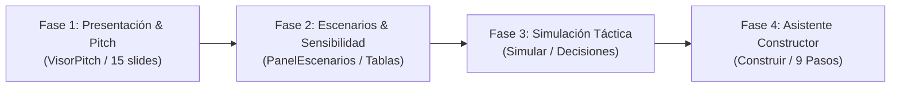

# Plan Maestro de Transformación Visual y Dirección de Arte — SimuladorPRO

> **Objetivo:** Eliminar el aspecto plano, genérico (*AI-slop*) y la sobrecarga de tablas crudas sin jerarquía en SimuladorPRO. Elevar la interfaz a un nivel editorial, ejecutivo y académico premium acorde a la identidad institucional de Bolivia.
> **Fuentes de Criterio Activas:** Pool de agentes central (`director-arte-coherencia`, `impeccable`, `ui-ux-pro-max`, `cerebros`).

---

## 1. Por qué mejorará radicalmente con esta propuesta

El problema detectado (*"se ve plana genérica iasloop llena de tablas que se pierden no se sabe dónde inicia termina ni qué transmite"*) se debe a que la IA que construyó estas vistas cayó en los **3 grandes vicios del código generado por IA**:

1. **Card-soup y Eyebrows mecánicos:** Envolver todo en tarjetas idénticas (`rounded-xl border bg-white p-4`) con un rótulo diminuto en mayúsculas (`NOTICIA DEL MES`, `CONCEPTO CLAVE`, `PRESENTACIÓN DE INVERSIÓN`). Visualmente todo compite y nada jerarquiza.
2. **Volcado de Base de Datos en vez de Storytelling:** Mostrar 30 números en una tabla sin decirle al cerebro humano: *«Aquí está la ganancia», «Este es el año donde recuperas», «Este es el riesgo que te quiebra»*.
3. **Incongruencia de Paleta:** El simulador nació como una plataforma crema y tinta azulada (`Crimson Pro` + `Atkinson`), pero el visor de presentación saltó a un *Dark Mode con neones morados y fucsias estilo Web3* que deja el 70% de la pantalla vacía.

Al aplicar los estándares de nuestro pool, **cada pantalla adquiere un centro de gravedad visual, una narrativa clara para el docente/inversionista y un acabado editorial pulido**.

---

## 2. Mapa de Fases de Ejecución

---

### FASE 1: Rediseño Integral de la Presentación (`VisorPitch` & `/presentar`)
* **Problema:** Portada con un vacío negro del 75%, colores neón morados/fucsias desalineados de la app, diapositivas con tablas y gráficos fríos sin titular que concluya.
* **Solución del Pool:**
  1. **Paleta Ejecutiva Sobria:** Reemplazar el fondo negro espacial y los halos morados por una estética editorial oscura premium (Azul noche grafito `#0b1329` / pizarra profunda con toques esmeralda institucional y marfil) o modo auditorio de alto contraste.
  2. **Portada con Ficha Ejecutiva:** El título principal convive con una ficha estructurada del proyecto:
     - Sector y Tipo de Negocio (con badge representativo).
     - Inversión Inicial Requerida (cifra destacada).
     - Horizonte del Proyecto y Ubicación real (ej. Parque Industrial Santiváñez, CBB).
     - Dictamen del Plan Base (`Proyecto Viable` / `Requiere Ajustes` con respaldo).
  3. **Láminas con Titulares de Conclusión (Storytelling):**
     - En vez de *"Flujo de caja"*, el titular afirma: *"El proyecto alcanza liquidez positiva en el Año 3 y acumula Bs 1.9M al cierre"*.
     - En vez de tablas crudas de números, destacar los **3 hitos**: Inversión Inicial (Año 0), Punto de Recuperación (Payback), Flujo Acumulado Final (Año 5).
  4. **Gráficos Recharts Humanizados:** Líneas y barras con grosores generosos, etiquetas directas en los puntos clave (anotaciones) y sin rejillas grises aburridas.

---

### FASE 2: Transformación de Escenarios y Análisis de Sensibilidad (`/escenarios`)
* **Problema:** Dos tablas gigantes ("Indicadores comparados" y "Flujo de caja año por año") con 35 números apiñados sin contraste ni guía visual.
* **Solución del Pool:**
  1. **Matriz Comparativa Ejecutiva:**
     - En vez de una grilla uniforme, los indicadores clave (**VAN** y **TIR**) se elevan a tarjetas heroicas con comparación directa frente al escenario Base.
     - Mostrar **Deltas relativos**: no solo `Bs 2.497.617`, sino un pill visual claro: `+Bs 2.22M (+807% vs Base)`.
  2. **Flujo de Caja Visual:**
     - Barra de progreso temporal de 5 años con el punto de cruce de equilibrio resaltado.
     - La tabla detallada año a año pasa a ser un desglose secundario ("Ver tabla de auditoría contable") para no abrumar al usuario con sábanas numéricas.

---

### FASE 3: Simulación Mensual y Sala de Decisiones (`/simular`)
* **Problema:** 5 cajas blancas idénticas de métricas, noticia del mes estática, 4 botones rectangulares estirados (A, B, C, D) con espacio muerto, gráficos cortados por scroll.
* **Solución del Pool:**
  1. **Tablero de Control Financiero (Dashboard de Cabina):**
     - Caja con semáforo de pista de despegue (*runway*).
     - Reputación y Merma con micro-medidores de nivel radiales o barras dinámicas.
  2. **Tarjetas de Decisión Táctica:**
     - Botones A, B, C, D transformados en tarjetas interactivas: selector circular contrastado, título en negrita, micro-impacto proyectado (Riesgo / Retorno / Plazo).
     - Animación suave de hover y foco accesible visible.

---

### FASE 4: Constructor y Coherencia General (`/construir`)
* **Problema:** Botones con 4 colores no coordinados, stepper de 9 números planos, acordeones de gastos toscos.
* **Solución del Pool:**
  1. **Agrupación Pedagógica del Stepper en 3 Fases:**
     - Fase I: Definición e Inversión (Pasos 1-3).
     - Fase II: Operación y Personal (Pasos 4-6).
     - Fase III: Estructura Financiera y Cierre (Pasos 7-9).
  2. **Tarjetas de Resumen y Acciones Primarias coordinadas** bajo el sistema LIENZO institucional.

---

## 3. Registro de Estado y Pruebas
- Total de pruebas en suite: **732 pruebas verdes (100% pasando)**.
- Regla: Toda mejora visual mantendrá los 732 tests verdes y cero regresiones en cálculos financieros o tipos TypeScript.
